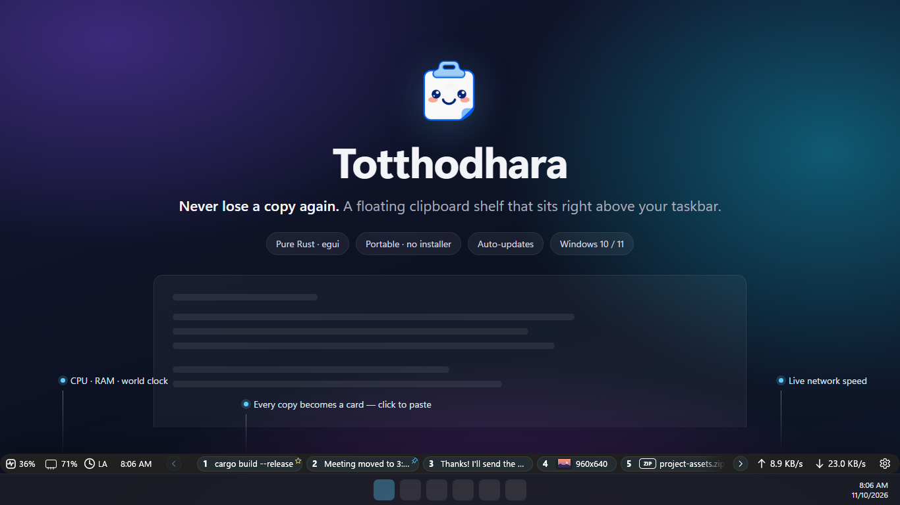
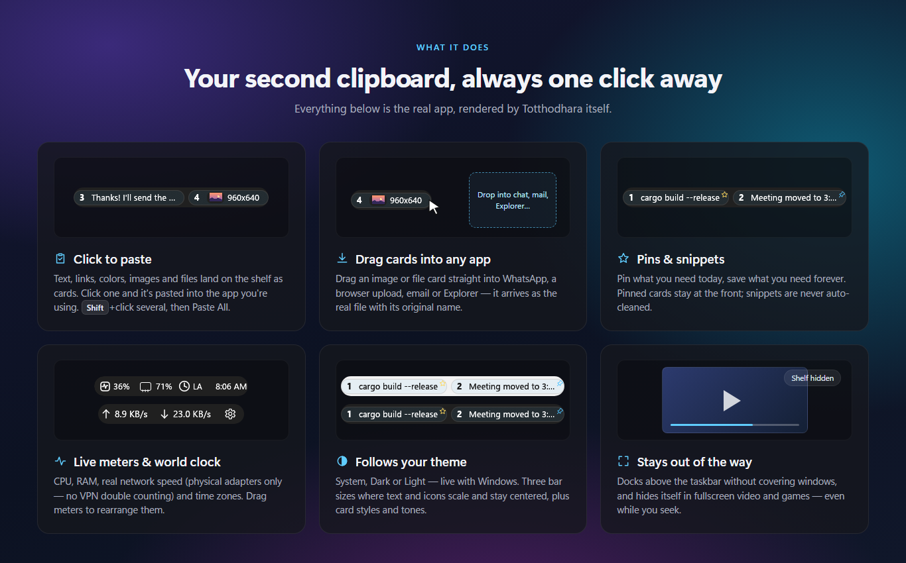
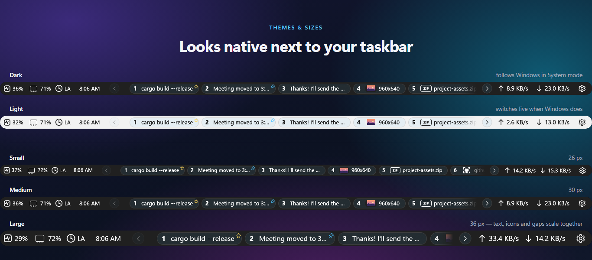
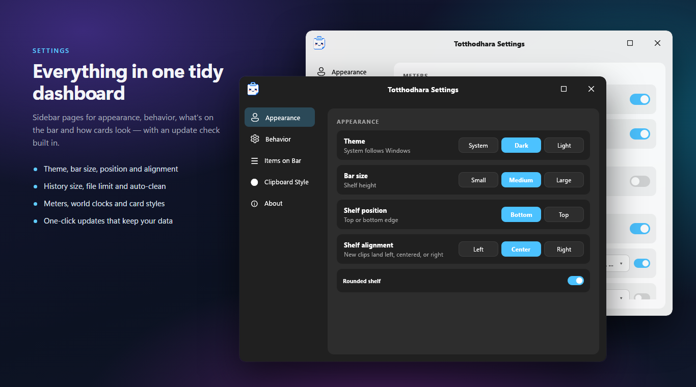

<p align="center"></p>

<p align="center">
  <a href="https://github.com/hungry-detective/Totthodhara/releases/latest"></a>
  <a href="https://github.com/hungry-detective/Totthodhara/releases/latest"></a>
  
</p>

<h3 align="center">Never lose a copy again.</h3>
<p align="center">A floating clipboard shelf for Windows that sits right above your taskbar.<br>Every text, link, color, image and file you copy becomes a card — click it to paste.</p>

---

## ⬇️ Download

1. Download **[`Totthodhara-windows-portable.zip`](https://github.com/hungry-detective/Totthodhara/releases/latest/download/Totthodhara-windows-portable.zip)** from the [latest release](https://github.com/hungry-detective/Totthodhara/releases/latest).
2. Extract it anywhere (Desktop, a USB stick, `C:\Tools`…).
3. Run `Totthodhara.exe`. There's no installer.

- **Portable:** history, settings and copied files live in the `data` folder next to the exe.
- **Auto-update:** the app checks on start (or Settings → About → Check for updates). It downloads the new zip, verifies its SHA-256, swaps the program files and restarts. Your `data` folder is never touched.
- **One shelf only:** starting it again replaces the running copy instead of opening a second shelf.

## ✨ What it does

<p align="center"></p>

- **Clipboard history:** text, links (with site icons), colors (with swatches), images (with thumbnails) and files.
- **Click to paste:** <kbd>Shift</kbd>+click selects cards for **Paste All**. <kbd>Ctrl</kbd>+click deletes a card.
- **Drag cards out:** drop an image or file card into WhatsApp, a browser upload, email or Explorer — it arrives as the real file with its original name.
- **Hover previews:** full images, full text and file details.
- **Right-click a card:** Pin, Save as snippet, Transform (UPPER, lower, Title, trim, sort, unique, join), Copy as HEX/RGB/HSL, Copy page title, Copy email or number, and Delete.
- **Search:** press <kbd>Ctrl</kbd>+<kbd>F</kbd>.
- **Meters:** CPU, RAM, real network speed and world clocks. Drag them to rearrange, or right-click to move them to the other side.
- **Fits around your work:** docks at the bottom or top of the screen without covering windows, and hides automatically while an app is fullscreen.

## 🎨 Themes & sizes

<p align="center"></p>

System, Dark or Light (switches live with Windows), glass and accent following, 6 card styles, 5 thumbnail frames and shelf tones. Small, Medium and Large scale text, icons and spacing together so everything stays centered.

## ⚙️ Settings

<p align="center"></p>

## Build from source

Requires Rust (stable) on Windows.

```powershell
cargo build --release          # target\release\Totthodhara.exe
.\package.ps1                  # dist\Totthodhara-windows-portable.zip + .sha256
.\package.ps1 -Publish -Notes "What changed"   # tag v<Cargo version> + GitHub release
```

To ship an update, bump `version` in `Cargo.toml` and `assets\app.manifest`, then run
`.\package.ps1 -Publish`. Installed copies pick it up automatically. The updater
only accepts the exact asset name `Totthodhara-windows-portable.zip`.

Set `TOTTHODHARA_DEV=1` to run a dev build beside an installed copy. In that
mode it skips the single-instance kill and mutex.

### README images

The images in `docs/` are made from real app frames, not mock-ups. Running the
exe with `TOTTHODHARA_SHOWCASE=bar:<out.png>` (or `settings0`…`settings4`)
renders one frame off-screen and saves it, without registering the shelf. The
HTML pages in `docs/source/` lay those frames out and are rendered to PNG with
headless Edge at 1366 px wide.

## Tech

The app is Rust with [egui](https://github.com/emilk/egui) and eframe (glow),
plus direct Win32 calls through the `windows` crate. Those calls handle the
AppBar dock, DWM glass, the clipboard listener, the tray icon, the global
hotkey (Ctrl+`) and SendInput paste. History is stored in SQLite (rusqlite,
bundled).
